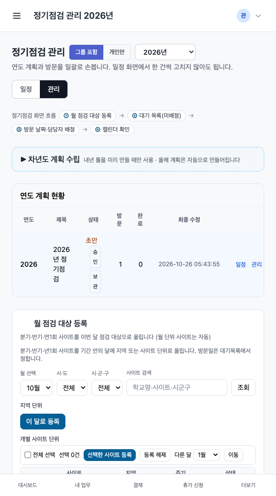
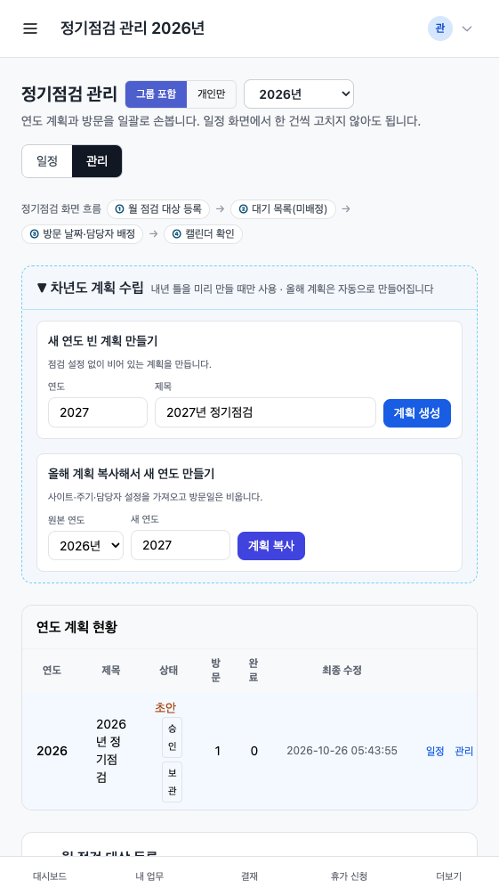
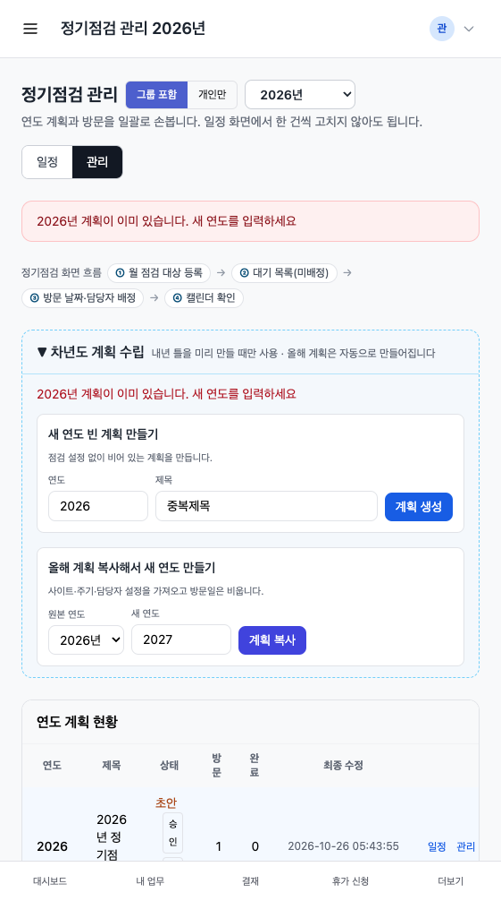

# 95-57단계 — 정기점검 관리 화면 재배치 (차년도 계획 수립 접기 박스)

기준: `커서_작업지시서_95-57_정기점검_화면_재배치_차년도계획수립_접기박스.md`  
시뮬레이션: `docs/시뮬레이션/정기점검_화면_시뮬레이션_차년도계획수립.html`  
실행일: 2026-10-26. 배포 이미지는 만들지 않음.

## 구역 순서 (위 → 아래)

| 순서 | 구역 | 구현 |
|---|---|---|
| 흐름 | 칩 한 줄 | ① 월 점검 대상 등록 → ② 대기 목록 → ③ 방문 날짜·담당자 배정 → ④ 캘린더 확인 |
| ⓪ | 차년도 계획 수립 | 관리자만, 기본 접힘, `localStorage` `maintNextPlanOpen`, 점선 테두리 |
| — | 연도 계획 현황 | 표 + 행 옆 초안/승인/보관 |
| ① | 월 점검 대상 등록 | 95-55 D-4·D-6 유지 |
| ②③ | 대기 목록(미배정) | 같은 박스, 버튼 「③ 날짜·담당자 일괄 배정」 |
| ④ | 정기점검 캘린더 | 일정 화면 링크 (캘린더 본체는 `/maintenance/:id`) |
| 기타 | 방문 일괄 담당자·삭제 | ④ 아래, 관리자만. 기존 URL 유지 |

사용자 확인 포인트: ③을 별도 구역으로 떼지 않고 ② 박스 하단 버튼으로 두었다.

## 기능

- `POST /maintenance`(생성), `POST /maintenance/:id/copy`(복사) 불변. 연도 2000 ~ 현재+5.
- 성공: 새 계획 관리 화면 + 「N년 계획을 만들었습니다」
- 중복/범위 오류: `open_next=1` 로 박스 펼침, 빨간 메시지, 연도·제목 보존
- 올해 계획은 `EnsureYearPlan`(월 대상 간이 등록)로 자동 생성 — 박스 없이도 동작

## 기존 기능 연동 점검표 (D-164)

- [x] 월 점검 대상 등록(95-49 지역 확대 · 95-55 D-6 선택 바)
- [x] 미배정 목록·일괄 배정(95-46 · 95-55 A-2 조직 격리)
- [x] 정기점검 캘린더·대기목록 접기(95-16/16A) — ④는 일정 화면 링크
- [x] 업무 등록 모달 정기점검번호(95-55 C)
- [x] 계획 상태(승인·보관) — 현황 표 행, ⓪ 박스 밖
- [x] 연도 계획 복사 시 `maintenance_site_config` 불변
- [x] 업무 관리 리스트·주간 보고 집계 — 방문/계획 생성 경로 동일
- [x] 메뉴·권한 — URL 변경 없음, 생성·복사는 조직/전사 관리자만
- [x] 고객 조회 공용 로직 — 이 화면에서 고객 select 추가 없음
- [x] 화면 개선 배치 — 제자리 수정, 예전 화면 분리 없음

## 테스트

`Test95_57ManageLayoutOrderAndCollapse`  
`Test95_57OrgAdminSeesBoxTechForbidden`  
`Test95_57CreateCopyDuplicateKeepOpenAndIsolation`  
`Test95_57EnsureYearPlanWithoutBox`  
`Test95_57AlpineStillCoversPlanManage`  
회귀: `Test95_55D*` `Test95_55B*` `TestManagePlanPageAndCopy` `Test95_55AlpineSyntaxAllTemplates`

- `go vet` (handler) 통과
- `go test ./internal/handler -run 'Test95_57|Test95_55D|Test95_55B|TestManagePlanPageAndCopy'` 통과
- `go test ./...` 전수는 `leaveapp` `TestPolicyCRequiresDeputy` 가 `SQLITE_BUSY` 로 한 번 실패했으나 95-57과 무관한 기존 잠금 이슈로 본다.
- `TestUILintRatchet` 는 레포 전반 baseline 불일치가 기존부터 있음. 이번 화면만 `plan_manage.html` raw_color 86→154 반영. 새 유틸은 기존 `border-dashed`/`bg-sky-50/40` 재사용, CSS 재빌드 없음.

## 구현 화면 캡처

접힘 / 펼침 / 중복 오류(박스 펼친 채 빨간 메시지, 입력 보존):

