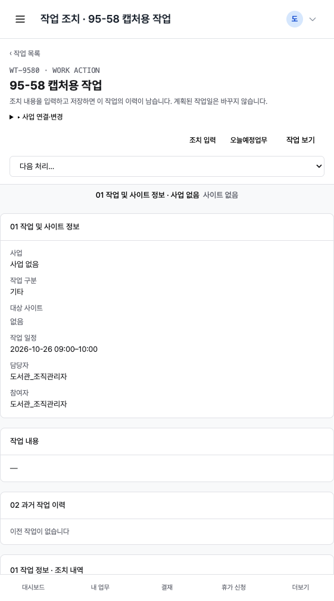
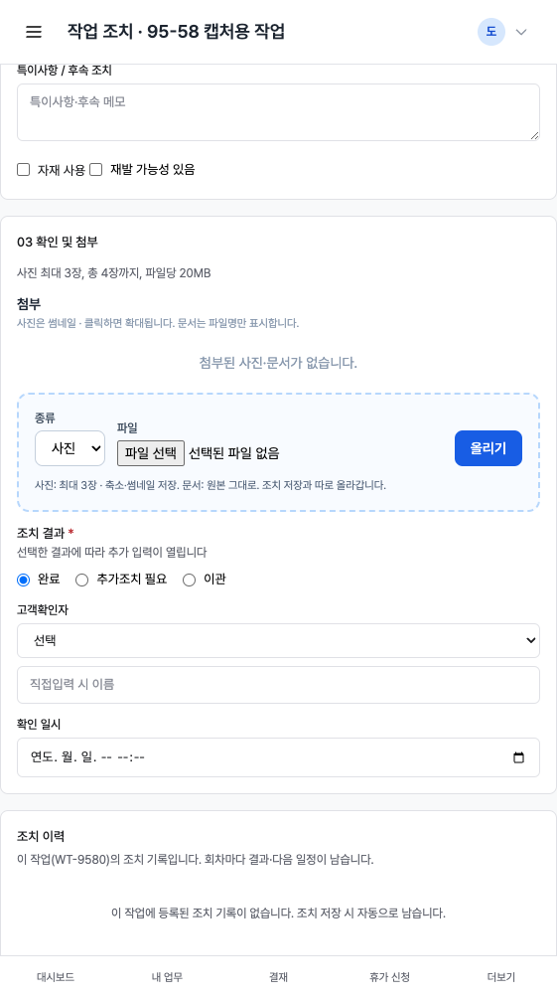
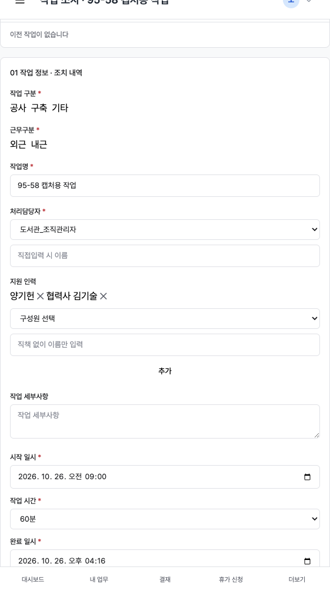
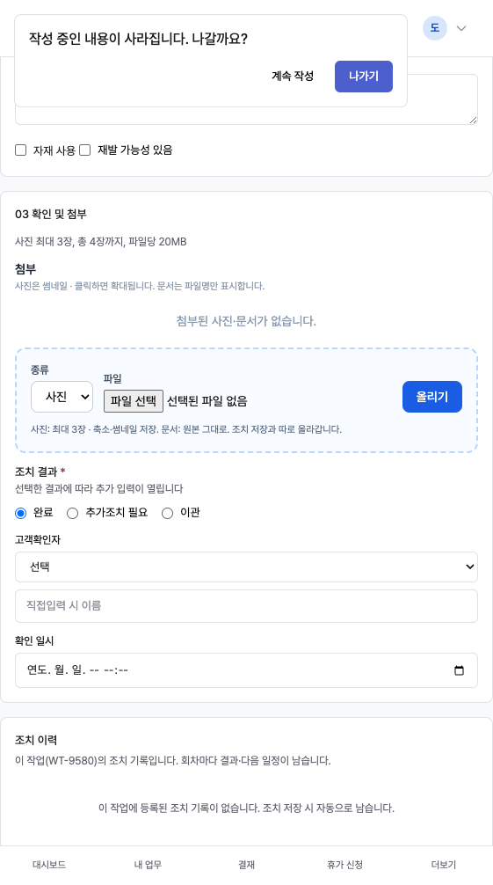

# 95-58단계 — 작업 조치 화면 개편

기준: `커서_작업지시서_95-58_작업조치_화면_개편_상하고정_지원인력_다중_취소버튼.md`  
기준 화면: `docs/figma/작업조치_화면_v1.png`  
선행: 95-56. 실행일: 2026-10-26. 배포 이미지는 만들지 않음.

지시서와 Figma가 다르면 **지시서 문장 우선**.

## 화면 항목 ↔ 기존 폼 필드 매핑

| 화면 항목 | 기존 `name` / 컬럼 | 95-58 |
|---|---|---|
| 작업 구분 공사/구축/기타 | `work_subtype` (`build`/`construction`/`other`) | 재사용. 카드형 라디오. 지시서 표의 「세부 유형 = work_subtype」과 겹치므로 **작업 구분 카드 = `work_subtype`** 으로 둔다 |
| 세부 유형 | `target_category_id` (작업 대상 분류) | 재사용. 분류가 없으면 칸을 숨기고 필수 아님 |
| 근무 구분 | `work_place` | 재사용 |
| 작업명 | `title` | 재사용, 수정 저장 |
| 처리담당자 | `assigned_to_code` / `assigned_to_custom` | 재사용(단일). AssigneePicker 위젯은 `assignee_user_id` 키가 주담당과 충돌해서 쓰지 않음 |
| 지원 인력 | `work_task_members` (`member_role=support`) | 재사용. `supporter_user_id`/`supporter_name`. 신규 테이블 없음 |
| 작업 세부사항 | `work_reason` | 재사용. 좌측 「작업 내용」은 계획 `description`(읽기전용) |
| 시작 일시 | — | **신규** `action_start_at` |
| 작업 시간 | — | **신규** `action_duration_min` (30·60·90·120·180·240·480 + 직접입력). 95-47 칩에 480 추가 |
| 완료 일시 | `complete_datetime` | 재사용. JS로 시작+시간 자동, 직접 수정 후 덮어쓰지 않음 |
| 조치 내용 | `action_taken` + `action_na` | 재사용 |
| 특이사항/후속 | `followup_note` 와 **다름**(추가조치 사유) | **신규** `action_remark` |
| 자재 사용 | 기존 parts | 재사용 |
| 재발 가능성 | — | **신규** `recurrence_possible` |
| 첨부 | `as_action_attach` | 재사용. 문구 「사진 최대 3장, 총 4장까지, 파일당 20MB」. 서버는 기존대로 사진 3장·20MB(총 4장 상한은 서버에 없음 → 아래 차이) |
| 조치 결과 | `result_code` | 재사용. 라디오 아래 추가 입력 펼침 |
| 고객확인자 | `customer_confirmer` + custom | 재사용 |
| 확인 일시 | — | **신규** `customer_confirmed_at` |
| 작업일 입력칸 | 없음(95-56) | 유지. 이력 `process_at` 날짜 = `action_start_at` 날짜. **`t.WorkDate` 불변** |

마이그레이션: `server/migrations/094_work_task_action_v58.sql` (+ InitDB `applyWorkTaskActionV94`).

## 지시서 vs Figma vs 구현 차이

- Figma 푸터 「임시저장」+「조치완료」 → 지시서대로 **임시저장 숨김**, 왼쪽에 **취소**.
- Figma 「WorkDesk」「김관리」 → **공통 헤더** 유지.
- Figma 작업 구분 카드만 있고 세부 유형 select → 지시서의 work_subtype 충돌을 위 매핑으로 해소.
- 지원 인력: AssigneePicker 공용 위젯 대신 **같은 후보 목록** + 칩. 키 충돌 방지.
- 첨부 「총 4장」은 화면 문구만. 서버 제한은 기존(사진 3, 20MB).
- 95-56 「완료일시 < 작업일」 확인 팝업 → 「시작일 ≠ 계획 작업일」 확인으로 **대체**. 완료 < 시작은 **오류**.

## 작업일 기준 조사 (주간 보고·리스트)

- 업무 관리 리스트·캘린더: `work_tasks.work_date`(계획일). 조치 저장이 이 값을 바꾸지 않으므로 **위치 유지**.
- 주간 보고 집계: `COALESCE(work_date, due_date, created_at)` — **계획일**. 실제 시작일(`action_start_at`)은 아직 안 씀.
- 조치 이력: `work_task_processes.process_at` = 시작 일시.

사용자 확인 포인트: 주간 보고를 실제 시작일 축으로 바꿀지는 **미적용**. 좌측 sticky는 가운데 스크롤 안 `position:sticky`(769px 이상). 작업 시간 옵션은 95-47 + 480분.

## 기존 기능 연동 점검표 (D-164)

- [x] 업무 관리 리스트·캘린더 — 계획 `WorkDate` 불변
- [x] 업무 상세 — 조치 링크 `/action` 유지
- [x] 주간 보고 — 작업일 축은 계획일(위 조사). 지원자는 `work_task_members` 동일
- [x] 95-25 담당자선택기 — 처리담당자는 기존 셀렉트. 지원 후보는 `listAssignableForPicker`(95-26 포함)
- [x] 95-26 타팀 지원자 — 후보 목록 규칙 불변
- [x] 95-47 소요시간 옵션 재사용(+480)
- [x] 첨부·자재 사용
- [x] 조치 이력 `InsertWorkTaskProcess` (`process_at` = 시작)
- [x] `SyncSitesOnProjectWorkComplete` — 완료 시 그대로
- [x] 잠금 해제 `unlock_password` 모달 유지
- [x] 95-56 오류 박스·입력 보존·`work_date` 폼 키 없음
- [x] 화면 개선 배치 — 제자리(`/workboard/tasks/:id/action`), 예전 화면 분리 없음

## 테스트

- `Test95_58_ActionLayoutRender` — 고정 위/아래, 스크롤 가운데, 임시저장 없음, 취소, 작업일 칸 없음, WorkDesk/김관리 없음, CSS 번들 클래스
- `Test95_58_FormKeysPostThreeResults` — 렌더 폼 파싱 POST 완료/일부/이관
- `Test95_58_WorkDateFromStartKeepsPlan` — 이력 날짜=시작일, 계획일 불변, 완료<시작 오류, 시작 누락 보존
- `Test95_58_SupportersAndCancel` — 구성원 2+직접 2, 주담당 중복, 취소 모달
- `Test95_58_ErrorKeepsSupporters` — 오류 시 칩·저장 바 위 오류
- `Test95_58_TimeHelpersAndJS` — `node --check` + 시작+30분
- `Test95_58_Migration094Columns`
- 회귀: `Test95_56_*` `TestProjectWorkAction*` `Test95_55AlpineSyntaxAllTemplates`

- `go vet ./...` 통과 (2026-10-26 재실행)
- `go test ./internal/handler ./internal/repository -count=1 -run 'Test95_58_|Test95_56_|TestProjectWorkAction|Test95_55AlpineSyntaxAllTemplates'` 통과
- 캡처는 로컬 `WT-9580` 조치 화면(모바일 폭). 데스크톱 sticky 열은 769px 이상에서 동작.

## 구현 화면 캡처

기본 / 오류 / 지원 인력 여러 명 / 취소 모달:

