# 95-69단계 — 모바일 화면 점검 (① 실측)

기준: `claude/커서_작업지시서_95-69_모바일_화면_점검_보완.md` (저장소에 없음, 채팅 요점). 이 단계는 화면 코드를 고치지 않았다. 폭 390·360, A등급만 캡처.

서버: `http://127.0.0.1:8080`  시각: 2026-10-29 18:48

## 화면 분류 (확인 요청)

### A — 현장·매일 (14)

① 단계에서 390·360 캡처·실측. 기술·지원이 매일 쓰는 화면.

| id | 경로 | 화면 |
|----|------|------|
| `login` | `/login` | 로그인 |
| `dashboard` | `/` | 대시보드 |
| `workboard_list` | `/workboard/board?view=list` | 일일 업무 리스트 |
| `workboard_day` | `/workboard/board?view=day` | 일일 업무 일 |
| `as_list` | `/as` | AS 접수·조치 목록 |
| `as_action` | `/as` | AS 조치 |
| `mnt_list` | `/maintenance` | 정기점검 목록 |
| `mnt_action` | `/maintenance` | 정기점검 조치 |
| `customers` | `/customers` | 고객현황 |
| `assets` | `/assets` | 설치자산 |
| `quotes` | `/quotes` | 견적·수주·계약 |
| `meeting` | `/meeting` | 일일 업무 회의 |
| `approvals` | `/approvals/inbox` | 결재할 문서 |
| `leaves` | `/leaves` | 휴가 신청 |

### B — 주간·조회 (18)

자주 보지만 현장 응급은 아님. ② 단계에서 필요 시 캡처.

| id | 경로 | 화면 |
|----|------|------|
| `workboard_week` | `/workboard/board?view=week` | 일일 업무 주 |
| `workboard_month` | `/workboard/board?view=month` | 일일 업무 월 |
| `work_groups` | `/work-groups` | 업무 그룹 |
| `as_kb` | `/as/knowledge` | AS 사례 검색 |
| `sales_dash` | `/sales/dashboard` | 영업 대시보드 |
| `sales_pipe` | `/sales?view=pipeline` | 파이프라인 |
| `sales_act` | `/sales/activities` | 영업 활동 |
| `projects_dash` | `/projects/dashboard` | 사업 대시보드 |
| `projects` | `/projects` | 사업 목록 |
| `stats` | `/stats` | 통계 |
| `weekly` | `/stats/company-weekly` | 주간 업무 보고서 |
| `contacts` | `/contacts` | 담당자관리 |
| `codes` | `/codes` | 코드관리 |
| `items` | `/items` | 품목 마스터 |
| `product_groups` | `/product-groups` | 제품군 관리 |
| `spaces` | `/spaces` | 공간관리 |
| `meeting_weekly` | `/meeting/weekly` | 주간 회의 (팀) |
| `meeting_me` | `/meeting/weekly/me` | 주간 회의 (내 자료) |

### C — 데스크톱·설정 (22)

표가 넓거나 관리 전용. 가로 스크롤을 표 영역에서 허용해도 되는 후보.

| id | 경로 | 화면 |
|----|------|------|
| `work_legacy` | `/work` | 오늘 업무 (예전) |
| `work_all` | `/work/all` | 전체 업무 (예전) |
| `register_legacy` | `/workboard/register` | 일일 업무 등록 (예전) |
| `reports_legacy` | `/stats/reports` | 보고서 (예전) |
| `as_legacy` | `/as?legacy=1` | AS 접수 상세 (예전) |
| `mnt_sites` | `/maintenance/sites` | 점검 사이트 설정 |
| `mnt_products` | `/maintenance/products` | 점검 제품 |
| `region_order` | `/maintenance/sites/distance` | 지역 거리 순서 |
| `contact_history` | `/contact-history` | 담당자이력 |
| `relations` | `/relations` | 수행관계 |
| `sales_groups` | `/sales/groups` | 사업 대분류 |
| `analysis` | `/analysis` | 교체대상현황 |
| `proj_import` | `/projects/import` | 사업 엑셀 등록 |
| `proj_docs` | `/projects/docs` | 서류 작성·관리 |
| `proj_diary` | `/projects/diary` | 업무일지·투입관리 |
| `proj_reg` | `/projects/registry` | 사업 등록 관리 |
| `milestones` | `/stats/milestones` | 마일스톤 |
| `admin_users` | `/admin/users` | 사용자/권한 |
| `admin_orgs` | `/admin/orgs` | 전체 조직 관리 |
| `admin_data` | `/admin/data` | 데이터 관리 |
| `admin_system` | `/admin/system` | 시스템 정보 |
| `labor_rates` | `/labor-rates` | 노임 단가 |

## 실측 결과 (A, 390·360)

점검: 문서 가로 스크롤, 잘린 표(스크롤 부모 없음), 44px 미만 터치, 고정 영역 겹침.

| 폭 | 화면 | 경로 | 가로스크롤 | 잘린표 | 터치<44 | 고정겹침 | 캡처 |
|----|------|------|------------|--------|---------|----------|------|
| 390 | 로그인 | `/login` | 없음 | 0 | 5 | 없음 | 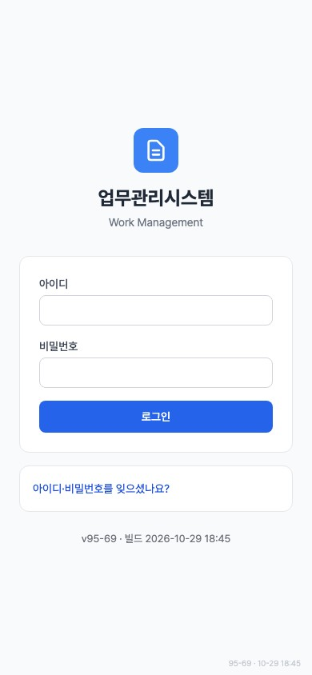 |
| 390 | 대시보드 | `/` | 없음 | 0 | 33 | 1 | 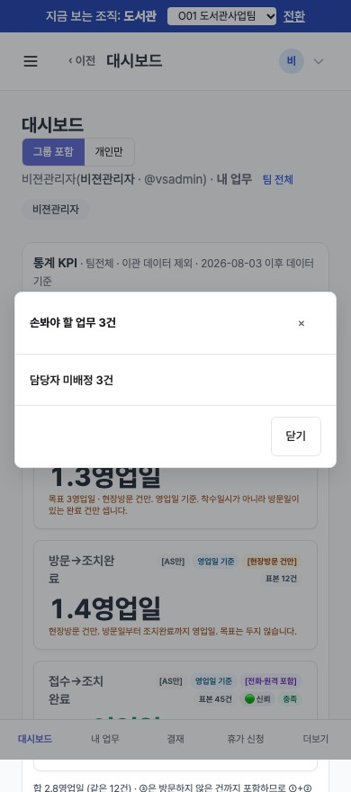 |
| 390 | 일일 업무 리스트 | `/workboard/board?view=list` | 없음 | 0 | 320 | 없음 | 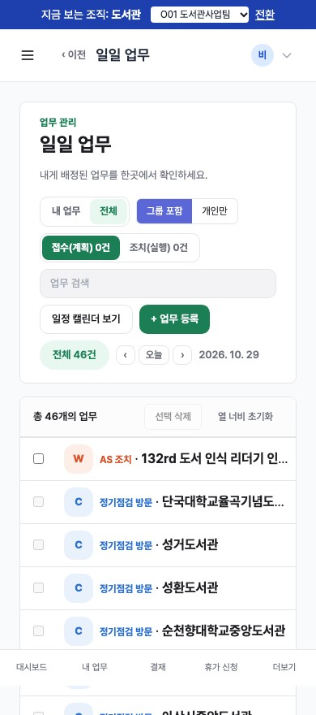 |
| 390 | 일일 업무 일 | `/workboard/board?view=day` | 없음 | 0 | 44 | 없음 | 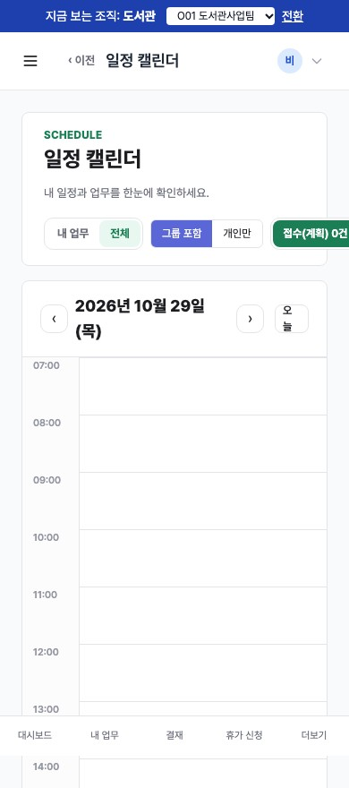 |
| 390 | AS 접수·조치 목록 | `/as` | 없음 | 0 | 90 | 없음 | 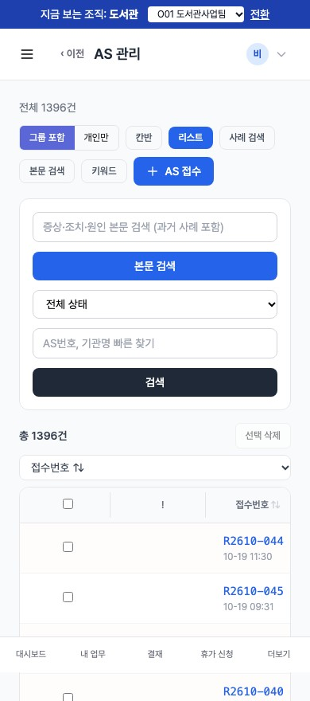 |
| 390 | AS 조치 | `/as/R2610-044/action` | 없음 | 0 | 59 | 없음 | 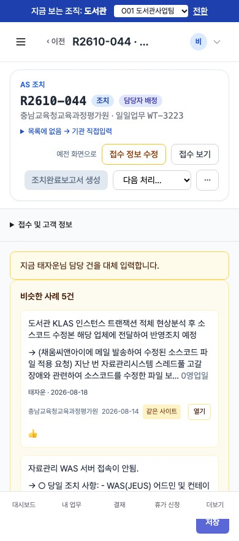 |
| 390 | 정기점검 목록 | `/maintenance` | 없음 | 0 | 131 | 없음 | 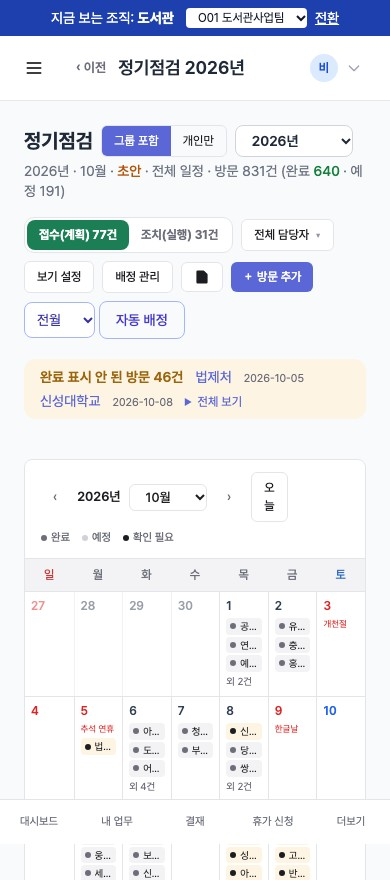 |
| 390 | 정기점검 조치 | `/maintenance` | — | — | — | — | 건너뜀 (대상 건 없음) |
| 390 | 고객현황 | `/customers` | 없음 | 0 | 108 | 없음 | 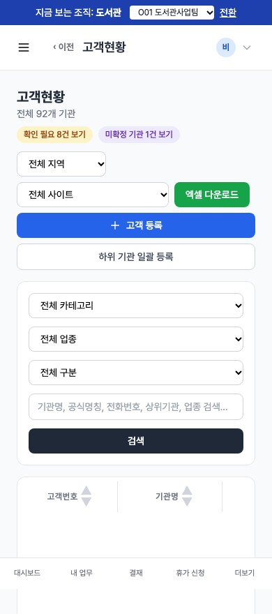 |
| 390 | 설치자산 | `/assets` | 없음 | 0 | 100 | 없음 | 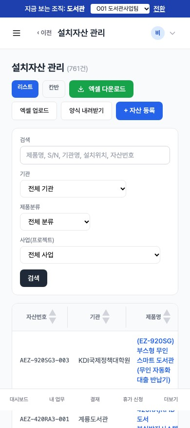 |
| 390 | 견적·수주·계약 | `/quotes` | 없음 | 0 | 34 | 없음 | 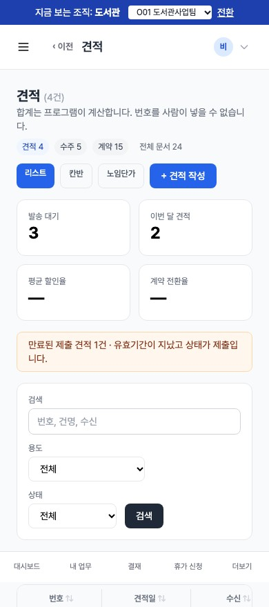 |
| 390 | 일일 업무 회의 | `/meeting` | 없음 | 0 | 16 | 없음 | 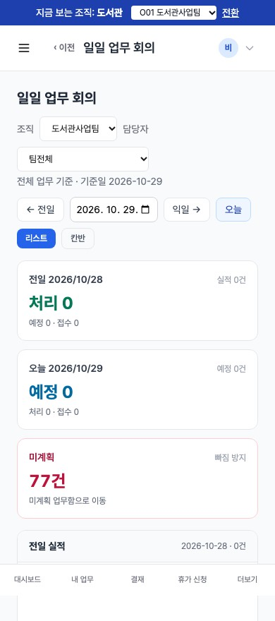 |
| 390 | 결재할 문서 | `/approvals/inbox` | 없음 | 0 | 10 | 없음 | 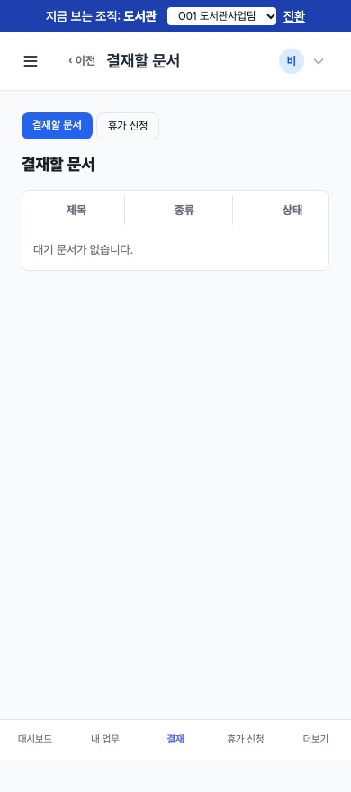 |
| 390 | 휴가 신청 | `/leaves` | 없음 | 0 | 11 | 없음 | 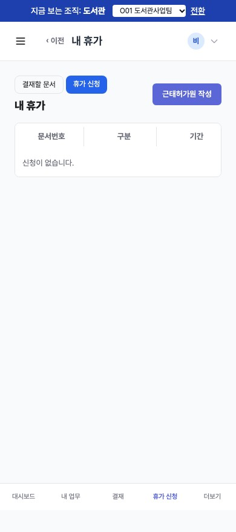 |
| 360 | 로그인 | `/login` | 없음 | 0 | 5 | 없음 | 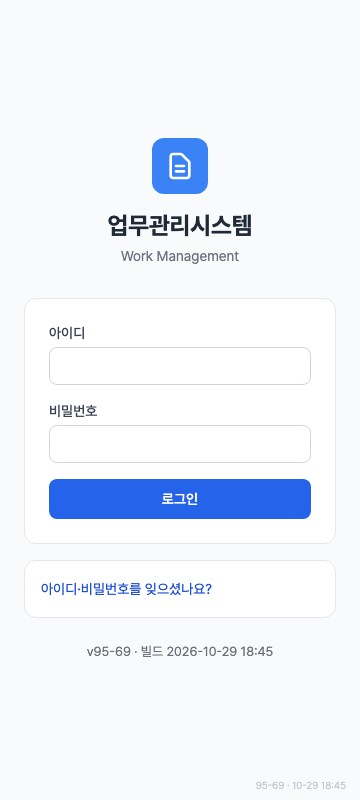 |
| 360 | 대시보드 | `/` | 없음 | 0 | 33 | 1 | 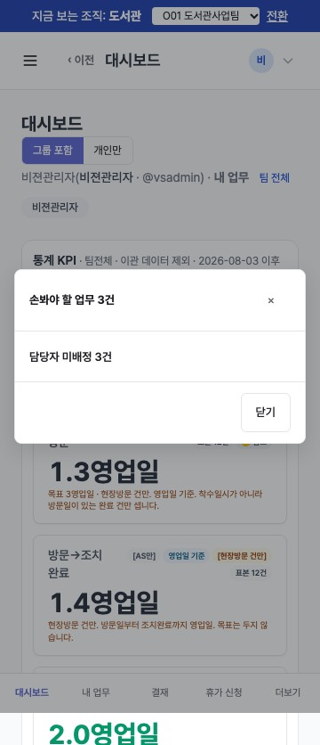 |
| 360 | 일일 업무 리스트 | `/workboard/board?view=list` | 없음 | 0 | 320 | 없음 | 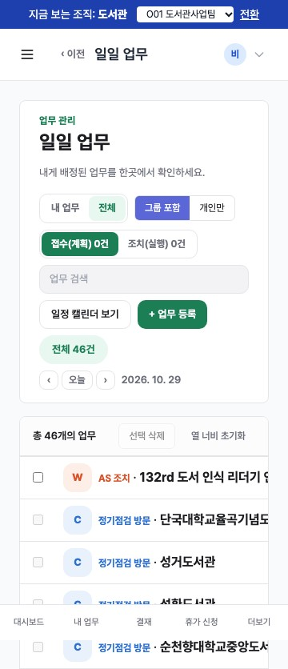 |
| 360 | 일일 업무 일 | `/workboard/board?view=day` | 없음 | 0 | 44 | 없음 | 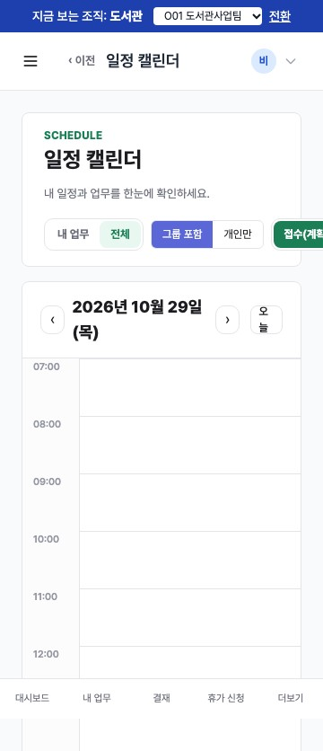 |
| 360 | AS 접수·조치 목록 | `/as` | 없음 | 0 | 90 | 없음 | 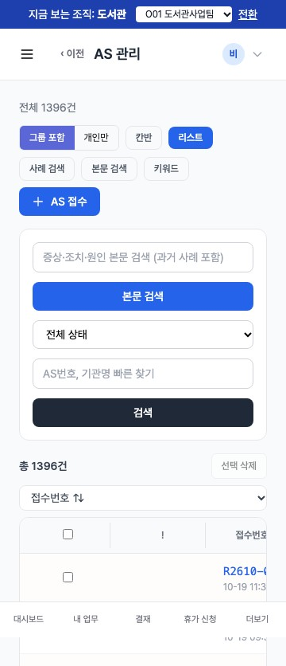 |
| 360 | AS 조치 | `/as/R2610-044/action` | 없음 | 0 | 59 | 없음 | 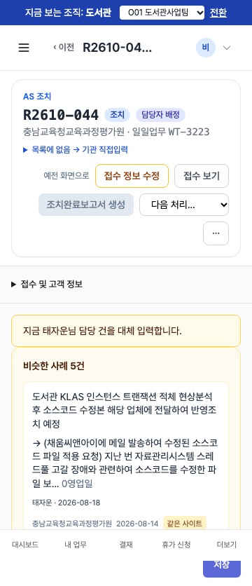 |
| 360 | 정기점검 목록 | `/maintenance` | 없음 | 0 | 131 | 없음 | 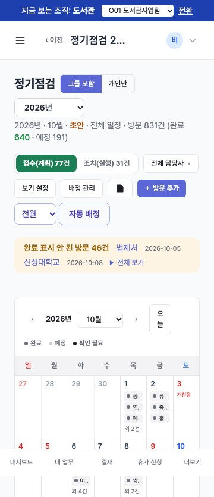 |
| 360 | 정기점검 조치 | `/maintenance` | — | — | — | — | 건너뜀 (대상 건 없음) |
| 360 | 고객현황 | `/customers` | 없음 | 0 | 108 | 없음 | 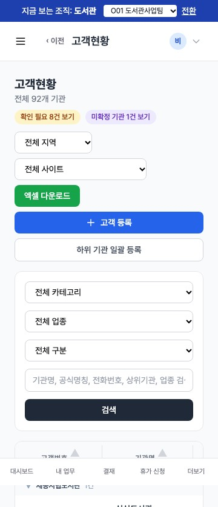 |
| 360 | 설치자산 | `/assets` | 없음 | 0 | 100 | 없음 | 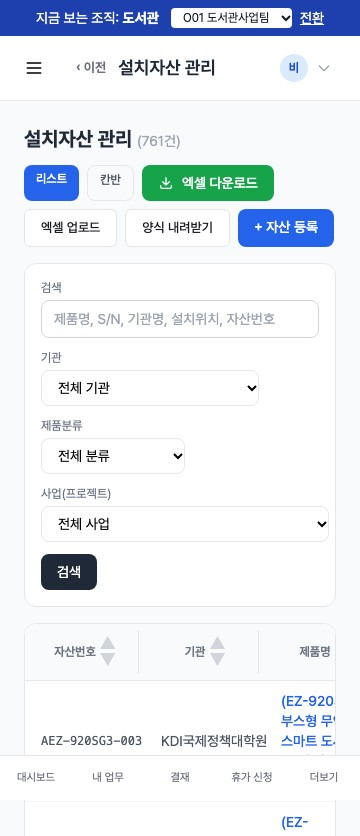 |
| 360 | 견적·수주·계약 | `/quotes` | 없음 | 0 | 34 | 없음 | 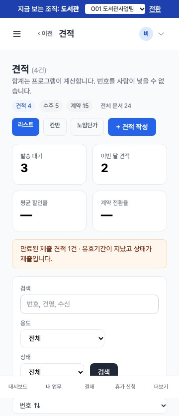 |
| 360 | 일일 업무 회의 | `/meeting` | 없음 | 0 | 16 | 없음 | 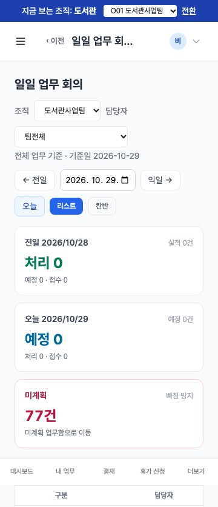 |
| 360 | 결재할 문서 | `/approvals/inbox` | 없음 | 0 | 10 | 없음 | 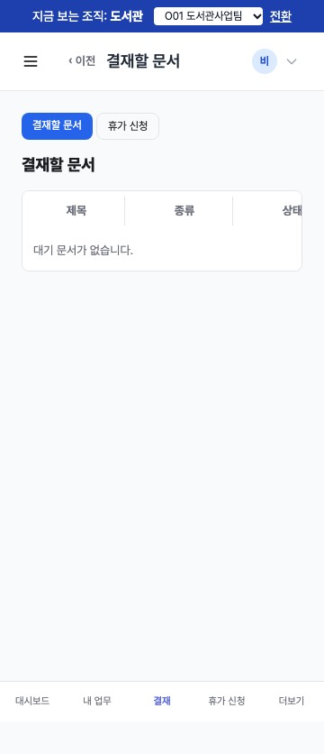 |
| 360 | 휴가 신청 | `/leaves` | 없음 | 0 | 11 | 없음 | 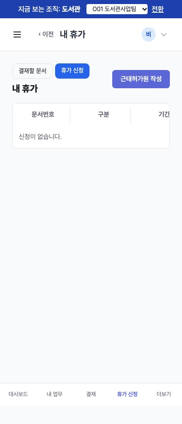 |

분류를 확인한 뒤 ② 단계(화면 수정)로 진행하면 된다.
