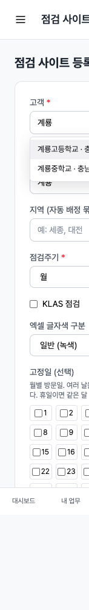
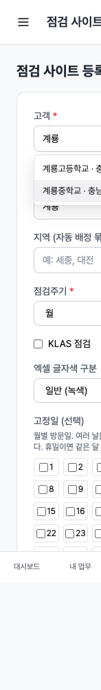
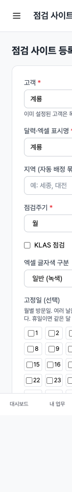
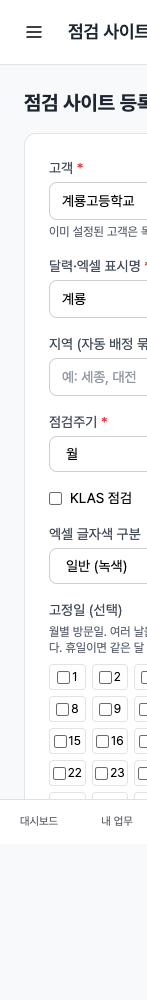
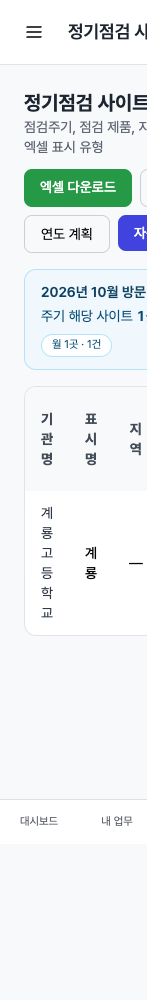

# 95-6단계 보고서 — 점검 사이트 등록 고객 검색

기준: `커서_작업지시서_95-6_점검사이트등록_고객검색.md` (D-130)  
실행일: 2026-10-20. 운영·개발 DB(`server/data/app.db`) 미변경. `server/data` 미커밋. 마이그레이션 없음.

## 시작 게이트

| # | 결과 |
|---|------|
| 95-5 | 완료 `d6cec24` · `8889c9b` · `f815abe` · `fdfa762` |
| 마이그레이션 | 없음 |
| 작업 트리 | tar·buildinfo·조치 화면·지시서 초안은 넣지 않음 |

## 동작

- `/maintenance/sites/new` 고객 항목은 `<select>` + 「선택」이 아니라 **빈 검색칸** + 숨은 `customer_id`.
- `GET /maintenance/sites/customer-search?q=` JSON. **2글자부터**, 최대 **20건**. 1글자는 빈 목록 + 「두 글자 이상 입력하세요」.
- 후보는 활성 고객, `party_kind=customer`, **사이트 미설정**, **조직 무관**(95-9A Q1). 이름·공식명·고객ID·시도·시군구·주소 부분 일치. 초성 검색 없음.
- 비젼관리자 전체 보기(`OrgAll`): 검색은 전 기관. 저장은 조직 미선택이면 400(「소속 조직을 선택하세요」).
- 목록에서 고르지 않고 제출하면 **400** + 「고객을 목록에서 선택해 주세요」. 표시명·지역은 다시 채움.
- 타 조직 `customer_id` 제출은 **허용**. 없는·비활성 고객만 거부.
- 수정 모드는 hidden 고객 유지. 95-5 점검 제품 체크는 그대로.

## 테스트

- 레포: 1글자 0건, OrgAll도 20건 상한, 이미 사이트·비활성·협력사 제외(타 조직 포함), 지역·ID 일치.
- HTTP: 폼에 「선택」 옵션 없음. `q=계룡`은 미설정 전 기관. 미선택 제출 400+표시명 유지. 타 조직 저장 303. 수정 화면 콤보박스 없음. vsadmin 전체 보기도 검색됨.
- `TestCustomer947SiteConfigNoOrgOnInsert`: 미입력은 400, 저장은 보기 조직 O02.
- `npm run build:css`(2026-10-21 재실행): `Done in 1557ms`. `vendor/tailwind.css` 워킹트리 차이 없음.
- `TestUILintRatchet`: 저장소 leftover. `site_form.html` baseline raw_color 25 → 실제 28(95-6 이전 HEAD와 동일). 이번 콤보 클래스(`combobox`/`combobox-list`/`combobox-option-on`)는 토큰이라 **95-6로 늘지 않음**. 전체 합계 8396 / 파일 157 / 템플릿 194. 신규 파일 위반 0 목표와 별도로 기존 파일 표류는 baseline 실패(항목 13)로 유지.

### `go test ./...` (server/, `-count=1`, 2026-10-21)

로그 `/tmp/gotest-95-6-wrap.log`. 비교는 `docs/리뷰/gotest-baseline-72A2.md` **이름**.

| 구분 | 테스트 | 비고 |
|------|--------|------|
| baseline 유지 | `TestAdminWorkAssetLinkAndASMoveHTTP` | handler |
| baseline 유지 | `TestASActionCauseCatsReplaceCauseTypeSelect` | |
| baseline 유지 | `TestASVisitDateCreatesDailyTaskAndRegisterPalette` | |
| baseline 유지 | `TestProcessConflictsExcelAndAdminTab` | |
| baseline 유지 | `TestMainListensBeforeHousekeeping` | |
| baseline 유지 | `TestDeliveriesHTTP_GoodsSplitSerialConsumableSkippedUnplanned` | |
| baseline 유지 | `TestItemsHTTP_ManufacturerSearchAndPartner` | |
| baseline 유지 | `TestLoginHelpHandleCompletesTask` | |
| baseline 유지 | `TestMeetingHTTP_YesterdayDoneTodayScheduled` | |
| baseline 유지 | `TestQuotesHTTP_FormB2GroupLaborRevisePurposeReverse` | |
| baseline 유지 | `TestQuotesHTTP_RecipientSearchAndInlineNewSales` | |
| baseline 이번 통과 | `TestSalesHTTP_SupplyDealTypeListAndAutoStage` | 목록에서 빼지 않음 |
| baseline 유지 | `TestUILintRatchet` | 위 leftover |
| baseline 유지 | `TestNoCompleteDatetimeUpdatedAtFallback` | repository |
| baseline 유지 | `TestListWorkToday_AppDBTimingAndCount` | |
| 불안정 | `TestPolicyCRequiresDeputy` | SQLITE_BUSY |
| 날짜 flake(95-5와 동일) | `TestRegisterShowsAllKLASVisitsForDay` | 방문일 2026-08-14 vs 오늘 2026-10-21 |
| 날짜 flake | `TestRegisterRepairsMismatchedVisitDates` | |
| 날짜 flake | `TestVisitDateChangeMovesDailyTask` | |
| 날짜 flake | `TestVisitMoveClearsOverlappingTime` | |
| 날짜 flake | `TestUnplaceMaintenanceStaysOffGrid` | |
| 날짜 flake | `TestUnplannedKanbanCountsMatchList` | |
| 날짜 flake | `TestUnplannedSortIconsKeepDefaultOrder` | |
| **95-6 아님** | `TestASPartsUsedSchema074NoSeed` | 95-8 WIP가 같은 워킹트리에 있어 함께 실패. 이번 단계 신규로 치지 않음 |
| **95-6 아님** | `TestASPartsUsedReplaceAndSummary` | 동일 |

**95-6 신규 실패 0.** `TestSiteCustomerSearchHTTP` · 레포 검색 테스트 단독 재실행 통과.

## 브라우저

격리 TEST만. `PORT=18086` · `DB_PATH=/tmp/jp-95-6-test/data/app.db` · 계정 `oa_test`. 운영·개발 `server/data/app.db` 미사용. 확인 후 서버 종료·`/tmp/jp-95-6-test` 삭제·시드 커맨드 제거.

폭 390px. 고객 칸에 「계룡」(2글자) → 후보 **계룡고등학교 · 충남**, **계룡중학교 · 충남**. ↓ 중학교 강조, ↑ 고등학교, Esc 목록 닫힘, Enter로 고등학교 선택(`customer_id=c-gyeryong`). 표시명 「계룡」으로 저장 → `/maintenance/sites`에 계룡고등학교 1행. 터치로 후보 선택 가능.

| 장면 | 파일 |
|------|------|
| 두 글자 후보 | `docs/리뷰/screenshots/95-6/95-6-mobile-candidates.png` |
| ↓ 둘째 항목 | `docs/리뷰/screenshots/95-6/95-6-mobile-arrowdown.png` |
| Esc 닫힘 | `docs/리뷰/screenshots/95-6/95-6-mobile-esc.png` |
| Enter 선택 | `docs/리뷰/screenshots/95-6/95-6-mobile-selected.png` |
| 저장 후 목록 | `docs/리뷰/screenshots/95-6/95-6-mobile-saved.png` |

## 다른 폼의 고객 `<select>` (이번 범위 밖)

이미 검색형인 화면은 목록에서 뺐다.

| 화면 | 파일 | 비고 |
|------|------|------|
| 설치자산 등록 | `asset/form.html`, `asset/list.html` | 전체 고객 select |
| 일일업무·관리업무 모달 | `workboard/_modals.html`, `_subtask_modal.html`, `admin_work/form.html`, `admin_work/_subtask_modal.html` | |
| 업무 상세 | `workboard/task_show.html` | |
| 사업 등록 | `project/form.html` | |
| 연락처 이력 | `contact_history/list.html` | |
| 이해관계 | `relation/form.html` | |
| 공간 | `space/list.html`, `space/edit.html` | |
| AS 지식 | `as/knowledge.html` | |
| 점검 계획 상세에 사이트 추가 | `maintenance/plan_show.html` | 고객 select가 남아 있음. 다음 후보 |
| 관리 데이터 | `admin/data.html` | |
| AS 접수 | `as/form.html` | **이미** 클라이언트 검색(`#as-customer-search`). 이번 미변경 |

## 운영

마이그레이션·시드 없음. 배포는 사용자 지시가 있을 때.

## 질문

없음.
