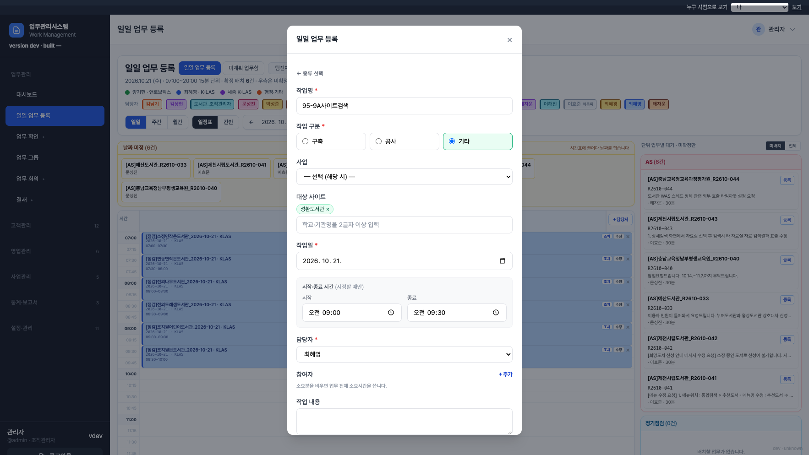
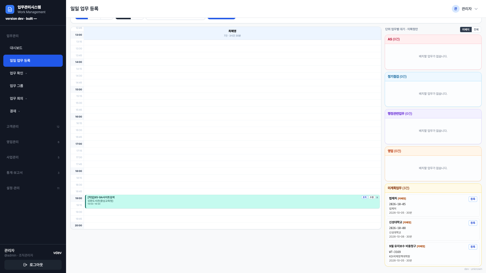
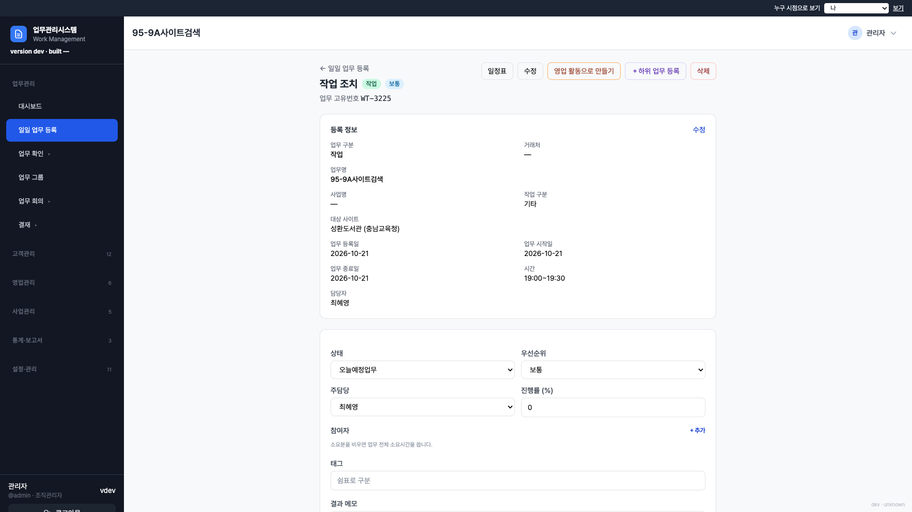

# 95-9A단계 보고서 — 작업 대상 사이트 전체 검색 · 사업 선택 사항

기준: `커서_작업지시서_95-9A_작업유형_사이트_전체검색.md` (D-138)  
실행일: 2026-10-21. 운영·개발 DB(`server/data/app.db`) 미변경. `server/data` 미커밋.  
`AppSchemaVersion` **72 유지**. InitDB에서 `applyWorkTaskSitesCustomer`(077)를 076 다음에 적용.

## 시작 게이트

| 항목 | 결과 |
|------|------|
| 마이그레이션 | **077** `077_work_task_sites_customer.sql` + `.down.sql`. 시드 INSERT 없음 |
| PK | `(task_id, customer_id)`. `project_site_id` NULL 허용 |
| 사업 | **완전 선택**. `ListWorkPickProjects` SQL **미변경** |
| 사이트 검색 | 활성 `customers` 전체. org 조건 없음. 2글자·최대 20건. LIKE ESCAPE |
| 응답 필드 | `site_id`(=customer_id)·`site_name`·`parent_name`·`region`·`on_project` |
| 92 allowlist | `SearchWorkTaskCustomers` — 「사이트는 조직별 관리가 아니다…」 |

## 5-1. 사업 목록이 비는 원인

조회: `WBRepo.ListWorkPickProjects(orgID)`

- 조건: `org_id = 현재 조직`, `status NOT IN ('archived','complete')`
- 정렬: `project_kind` 구축(0) → 공사(1) → 그 외, 이름
- `org_id` 공백·전체보기(`*`)면 빈 목록

로컬 `server/data/app.db` **읽기 전용** 건수 (2026-10-21):

| 조직 | `work_projects` 전체 | 위 조건(취소·종료 제외) |
|------|----------------------|-------------------------|
| O01 (도서관) | 15 | **15** |
| O03 (SI) | **0** | **0** |

판정: **데이터 부재**. SI 조직관리자 화면의 빈 드롭다운은 조회가 과해서가 아니라 `work_projects`에 O03 행이 없기 때문이다. 지시서대로 **pick SQL은 바꾸지 않았다.** 빈 칸 안내만 「등록된 사업이 없습니다」(O04 HTTP 테스트). O01 등록 화면에는 안내가 없고 사업 옵션이 나온다.

## `work_task_sites` 이관

이관 전 로컬 개발 DB: **0행**, 컬럼 `task_id`/`site_id` (운영·개발 파일 그대로 유지).

- 고객 연결된 `project_sites`만 `customer_id`로 복사. 미연결 행은 **복사하지 않음**(Q2).
- `Test077WorkTaskSitesCustomerNoSeed`: 연결 1행 이관, 미연결 leftover **1행은 폐기**. down 후 `site_id` 복구.
- 077 적용 뒤 076이 `ix_wts_site(site_id)`를 다시 만들려 하지 않도록, 이미 `customer_id` 스키마면 076 apply를 건너뛴다.

## 동작

- `GET /workboard/work-sites/search?q=` (+ 선택 `project_id`, `selected`). 별칭 `GET /workboard/project-sites`.
- 저장: `site_id` 폼 값 = 고객 ID. 활성 고객만. 사업 없어도 사이트만, 사이트 없이도 가능.
- 선택한 기관이 그 사업 `project_sites`에 있으면 칩 「사업 대상」. 아니면 배지 없이 허용.
- 95-3 사이트 상태 동기화는 `project_site_id`가 있는 행만. 미연결 고객은 건너뜀.
- 읽기 전용·C-Level 검색 403. 타 조직 `project_id`는 배지 생략(400 아님). 타 조직 **사업 저장**은 기존처럼 400.
- 상세 등록 정보·일정표 카드 부제·칸반에 고객명(+상위기관).

## 테스트

- `Test077WorkTaskSitesCustomerNoSeed`
- `TestSyncSitesOnProjectWorkComplete` — 미연결 CD 동기화·이력 없음
- `TestProjectWorkModalFiveKindsAndSave` / `TestProjectWorkSitesAndSearch` / ACL·O03 교차
- `TestOrgScopeStaticAudit` — allowlist 사유에 `95-9A`

`go test ./internal/repository -run 'Test077|TestSyncSites|TestOrgScopeStaticAudit'` · `go test ./internal/handler -run TestProjectWork` **통과**.

### `go test ./...` (`server/`, `-count=1`, 2026-10-21)

로그 `/tmp/gotest-95-9A.log`. 비교는 `docs/리뷰/gotest-baseline-72A2.md` **이름**.

| 구분 | 테스트 | 비고 |
|------|--------|------|
| baseline 유지 | handler HTTP 다수 | leftover |
| leftover | `TestUILintRatchet` | 기존 템플릿 표류. **신규 템플릿 파일 0** |
| leftover | `TestNoCompleteDatetimeUpdatedAtFallback` · `TestListWorkToday_AppDBTimingAndCount` | |
| 날짜 flake | `TestRegisterShowsAllKLASVisitsForDay` 등 | 95-5·95-9와 동일 |
| 불안정 | `TestPolicyCRequiresDeputy` | SQLITE_BUSY |
| 이번 단계 테스트명 FAIL | 없음 | **신규 실패 0** |

`npm run build:css` 이번 단계 CSS 파일 변경 없음(유틸 클래스는 기존 빌드에 있음).

92: `SearchWorkTaskCustomers`만 조직 필터 예외. 다른 검색으로 번지지 않음.

## 브라우저

격리 TEST만. `PORT=18092` · `DB_PATH=/tmp/jp-95-9A-test/data/app.db`(개발 DB 복사). 계정 `admin`(O01). 확인 후 서버 종료·복사본 삭제. `server/data/app.db`는 이관 전 스키마(`site_id`)·0행 유지.

흐름: 「작업」 → 사업 비움 → 「성환」 검색 → `성환도서관 · 충남교육청 · 천안시 서북구` → 칩 선택 → 저장 `WT-3225` · `work_task_sites` 1행(`C041-26-011`, `project_id` NULL) → 일정표 `[작업]95-9A사이트검색` + `성환도서관(충남교육청)` → 상세 「대상 사이트」.

첫 저장은 19:00 겹침으로 실패했다가 재제출로 저장됨(시각은 19:00~19:30).

| 장면 | 파일 |
|------|------|
| 1440 검색 폼 | `docs/리뷰/screenshots/95-9A/95-9A-form-1440.png` |
| 390 폼 | `docs/리뷰/screenshots/95-9A/95-9A-form-390.png` |
| 820 폼 | `docs/리뷰/screenshots/95-9A/95-9A-form-820.png` |
| 1440 일정표 카드 | `docs/리뷰/screenshots/95-9A/95-9A-register-1440.png` |
| 1440 상세 | `docs/리뷰/screenshots/95-9A/95-9A-task-1440.png` |

## 질문 (임의 결정 금지)

- **Q1:** 「조직별로 관리하는 사이트가 없다」를 정기점검 사이트 등록의 고객 검색(95-6)에도 적용할지. 지금은 현재 조직 고객만.
- **Q2:** 마이그레이션 시 고객 미연결 `project_sites` 연결 행. 로컬 개발 DB **0건**. 단위 테스트 leftover **1건은 복사하지 않고 폐기**. 운영은 해당 표 없음. 이 폐기 방식을 유지할지.
- **Q3:** 사업 목록이 빈 원인은 데이터 없음으로 확인했고 pick SQL은 안 바꿨다. 이대로 종료해도 되는지.
