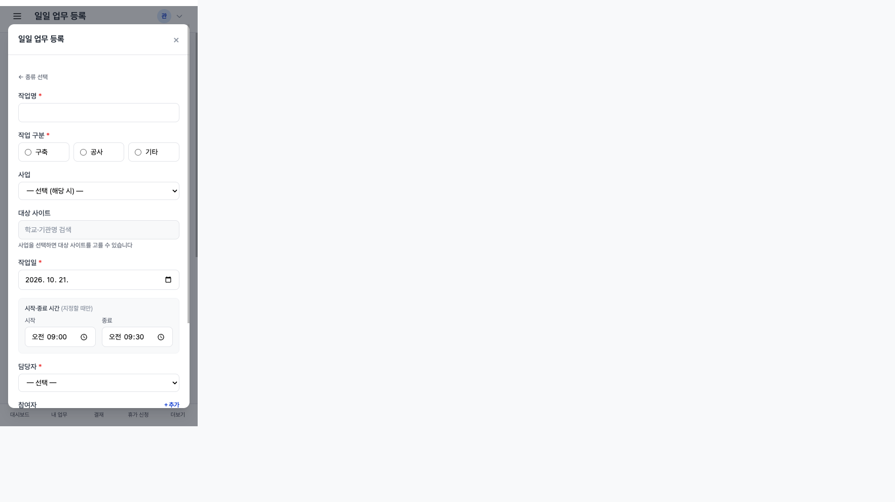
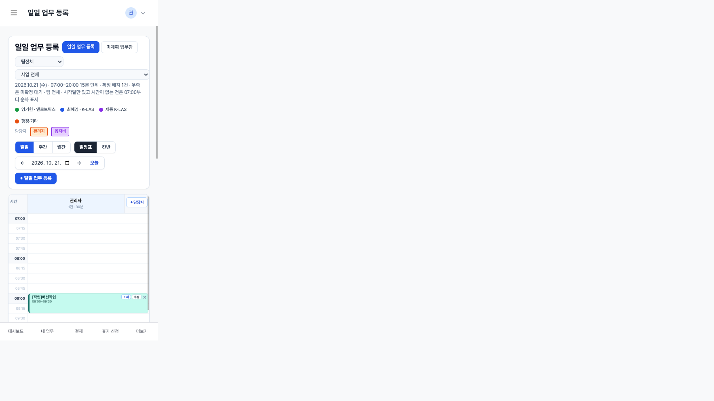
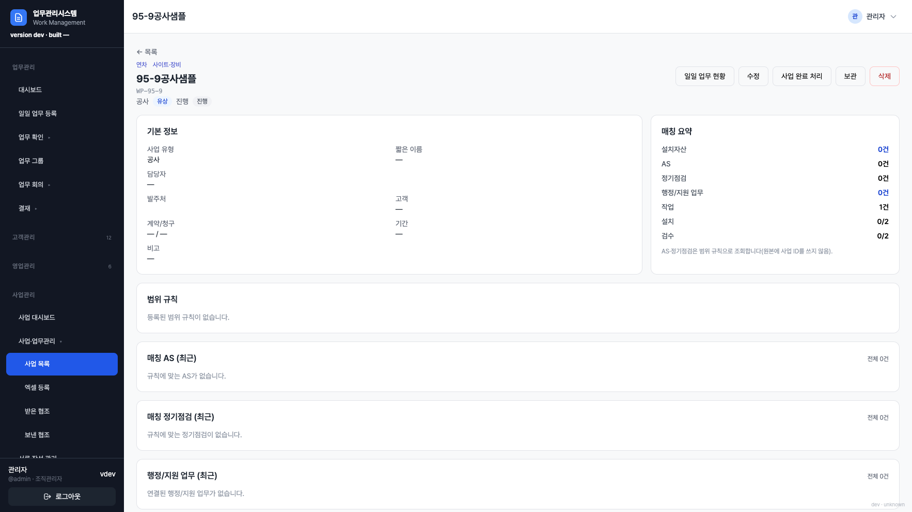

# 95-9단계 보고서 — 일일 업무 「작업」 유형 (구축·공사)

기준: `커서_작업지시서_95-9_일일업무_작업유형_구축공사.md` (D-137)  
실행일: 2026-10-21. 운영·개발 DB(`server/data/app.db`) 미변경. `server/data` 미커밋.  
순서: **95-4 이후, 95-6 앞**(의존 95·95-3 완료 상태). `AppSchemaVersion` **72 유지**. InitDB에서 `applyWorkTaskProjectWork`(076) 적용.

## 시작 게이트

| 항목 | 결과 |
|------|------|
| 마이그레이션 | **076** `076_work_task_project_work.sql` + `.down.sql`. 시드 INSERT 없음 |
| `work_subtype` | `TEXT NOT NULL DEFAULT ''` (`build`·`construction`·`other`) |
| `work_task_sites` | PK `(task_id,site_id)` + `ix_wts_site`. 업무 삭제 시 코드에서 함께 삭제 |
| 사업 연결 | **선택**. 비우면 사이트 비활성 + 「사업을 선택하면 대상 사이트를 고를 수 있습니다」 |
| 사이트 검색 | 95-6과 동일: **2글자·최대 20건**. 제외(`excluded`) 제외 |
| 일정표 색 | `ColorProjectWork` 에메랄드. `[작업]`은 표시만, 저장 `title`은 원문 |
| 사이트 상태 자동 변경 | **하지 않음**(Q1) |

## 동작

- 등록 팝업 종류 카드 **5개**. 「작업」 설명: 「구축·공사 작업을 일일 업무로 등록합니다.」
- `POST /workboard/tasks` `work_type=project_work`. 필수: 작업명·구분·작업일·담당자. 시간은 지정할 때만 15분·겹침·기본 30분.
- 시간 없으면 `work_date` 비움 → 팔레트 「작업」 구역. 시간은 일정표에 즉시 배치.
- 사업은 현재 조직의 진행/예정 계약, 구축·공사 종류 우선 정렬. 타 조직 사업·타 사업 사이트·제외 사이트는 400.
- `org_id`는 현재 조직. `"*"` 금지. 비전 전체 보기(`OrgAll`)는 등록 시 「조직을 선택하세요」.
- 읽기 전용·C-Level: 등록 불가(기존 가드). C-Level GET `/workboard/register`는 기존처럼 403.
- 완료 시 결과 메모. 상세에서 사이트 칩 제거·검색 추가.
- 사업 상세 매칭 요약 「작업 N건」 + 「작업 (최근)」. 사이트 진행률(설치/검수)은 작업 완료와 **무관**.

저장 버그 수정: `normalizeWorkTask`가 `project_work`를 `admin`으로 덮어쓰던 default를 고쳐 `WBWorkProjectWork`를 유지한다. 일정표 일 뷰는 `WorkCardColorParts`로 작업은 담당자 색보다 구분 색.

## `work_type` 분기 전수 점검표

`rg` 대상: `work_type IN (` · `switch t.WorkType` · `NormalizeDirectWorkType` · `WBWorkTypeBucket` · `WorkTaskActClass`.

| 위치 | 판정 |
|------|------|
| `normalizeWorkTask` | **수정**. `project_work`를 `admin`으로 바꾸지 않음 |
| `WBWorkTypeBucket` / `NormalizeDirectWorkType` / `WBWorkTypeLabel` | `project_work` → 「작업」. default는 행정+지원만 |
| `WorkTaskActClass` | `project_work` → `work`(작업). default 「기타 업무」는 기존 행정·영업 |
| `IsAdminGTDTask` | 작업은 GTD 대상 아님(의도) |
| `queryWorkTasks` IN `admin,support,sales,project_work` | 오늘/전체·미계획·회의 일정 **포함** |
| `work_board_repo` IN `admin,support`만 | 행정 전용 버킷. **작업 미포함(의도)**. 행정 집계가 작업으로 늘지 않음 |
| `stats_overview.countProjectWorkSlice` | 별도 슬라이스. 접수/처리 합계에 포함 |
| `stats_work` / `wb_completed` / `stats_weekly` / `company_weekly` / `stats_dashboard` IN `admin,support` | **행정 KPI 전용**. 작업 넣으면 기존 행정 숫자가 바뀜 → **미포함(의도)** |
| `stats_daily_assignee` 완료 | `project_work` 포함 |
| `work/_filters` kind `project_work` | 업무처리현황 필터 「작업」 |
| `work_status` 팔레트 | `WorkCards` |
| 칸반 유형 열 | 작업 포함, 열 수 5(≤7) |

새 값이 `default`에서 「기타」로만 보이거나 총합에서 빠지는 경로는 위 표에서 고쳤거나 행정 전용으로 남겼다.

## 테스트

- `Test076WorkTaskProjectWorkNoSeed` — up/down, 시드 없음, 기존 행 `work_subtype=''`
- `TestWBWorkTypeProjectWorkBucketAndLabel` · `FormatTaskSiteLine`
- `TestWorkCardColorStyle` — 작업은 담당자 색보다 에메랄드
- `TestCountProjectActivities` — 작업 건수
- `TestProjectWorkModalFiveKindsAndSave` — 카드 5·필수 400·사업 없이 저장·`[작업]` 미저장·일정표 배지·색·겹침·팔레트·`data-kind`
- `TestProjectWorkSitesAndSearch` — 다중 사이트, 제외/타사업/타조직 400, 1글자 0건, 계룡 2건, 수정·완료 메모·사이트 1곳
- `TestProjectWorkOrgIsolationSearch` · `TestProjectWorkACLAndCrossTask` — O03 검색 400, 타 조직 상세 404, 읽기전용 403
- `TestFilterWorkItemsAssigneeOrAndKind` — kind=작업
- `TestOrgScopeStaticAudit` 통과

### `go test ./...` (`server/`, `-count=1`, 2026-10-21)

로그 `/tmp/gotest-95-9.log`. 비교는 `docs/리뷰/gotest-baseline-72A2.md` **이름**.

| 구분 | 테스트 | 비고 |
|------|--------|------|
| baseline 유지 | `TestAdminWorkAssetLinkAndASMoveHTTP` 등 handler 다수 | 기존 leftover |
| 날짜 flake | `TestRegisterShowsAllKLASVisitsForDay` 등 | 95-5·95-6과 동일 |
| 불안정 | `TestPolicyCRequiresDeputy` | SQLITE_BUSY |
| leftover | `TestUILintRatchet` | 아래 |
| leftover | `TestNoCompleteDatetimeUpdatedAtFallback` · `TestListWorkToday_AppDBTimingAndCount` | repository |
| leftover | `TestMainListensBeforeHousekeeping` | |

**95-9 신규 실패 0.** `TestProjectWork*` 단독 통과.

`npm run build:css`: Done in 2459ms. `vendor/tailwind.css` 이번 단계 클래스 반영.

`TestUILintRatchet`: 저장소 leftover + 이번 `_modals.html`(133→176 raw_color, emerald 카드/칩), `task_show.html`(260→270), `register.html`·`kanban.html`·`stats/overview.html`·`project/show.html` 소폭. **신규 템플릿 파일 0**. 전 저장소 baseline 일괄 갱신은 하지 않음(다른 WIP 파일 위반이 섞임).

92: `TestOrgScopeStaticAudit` 통과. 사이트 검색·사업 후보는 `org_id` 조건. 교차 HTTP는 O03 vs O01.

## 브라우저

격리 TEST만. `PORT=18089` · `DB_PATH=/tmp/jp-95-9-test/data/app.db` · 계정 `admin`. 공사 샘플 사업 `WP-95-9` + 사이트 2곳은 TEST DB에만 INSERT. 운영·개발 `server/data/app.db` 미사용. 확인 후 서버 종료·`/tmp/jp-95-9-test` 삭제.

흐름: 팝업 「작업」 → 사업 95-9공사샘플 + 사이트 2곳 + 09:00–09:30 저장 → 일정표 `[작업]배선작업` 에메랄드 카드 → 상세에서 사이트 1곳 제거·완료+「배선 완료」 → 사업 상세 **작업 1건**. 설치/검수는 0/2 유지. 390에서 팝업 `scrollWidth=clientWidth=390`.

| 장면 | 파일 |
|------|------|
| 390 작업 폼 | `docs/리뷰/screenshots/95-9/95-9-modal-390.png` |
| 390 일정표 카드 | `docs/리뷰/screenshots/95-9/95-9-register-390.png` |
| 820 | `docs/리뷰/screenshots/95-9/95-9-register-820.png` |
| 1440 | `docs/리뷰/screenshots/95-9/95-9-register-1440.png` |
| 사업 상세 작업 1건 | `docs/리뷰/screenshots/95-9/95-9-project-workcount.png` |

## 질문 (임의 결정하지 않음)

- **Q1:** 작업 완료 시 대상 사이트 상태(설치/검수)를 제안·연동할지, 95-3 사이트 행에서 작업 이력을 볼지. 이번 단계는 둘 다 하지 않았다.
- **Q2:** 작업 구분을 「구축/공사/기타」 외에 설치·배선·시험 등으로 더 나눌지.
